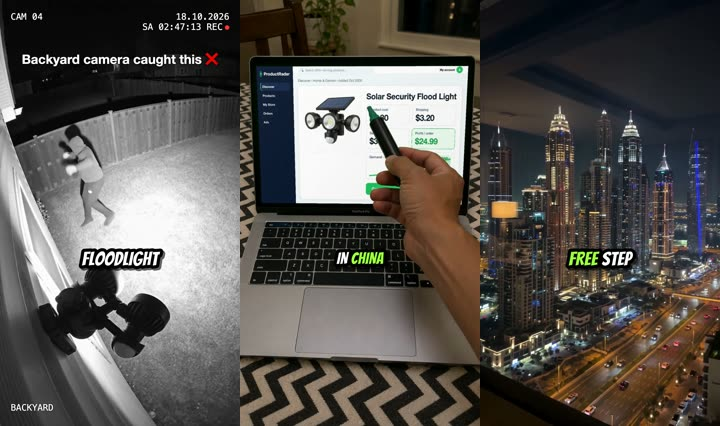
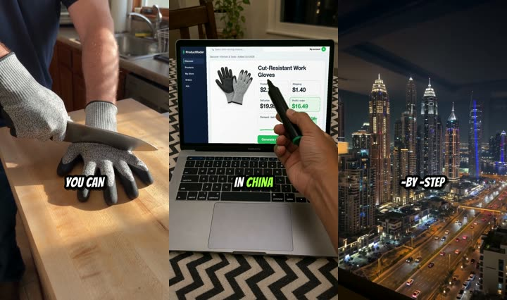
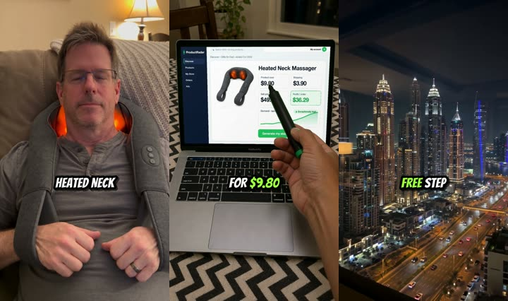
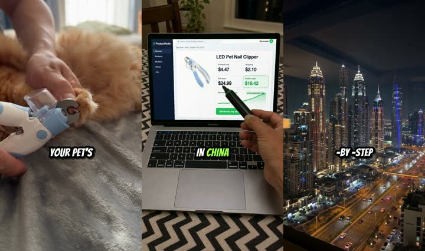
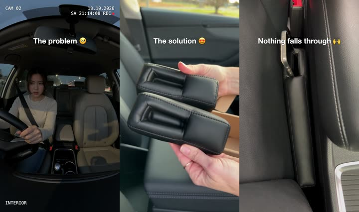

# How to make AI videos for dropshipping (2026 tutorial + 5 examples)

Turn one product photo into a 60-second dropshipping video ad for TikTok and Reels: an AI hook of the product in use, a hand pointing a marker at the cost, the price and the demand chart on a laptop, the steps, word-by-word captions and a "Comment GUIDE" ending. Every shot is made with AI on [varg.ai](https://varg.ai): about **$8.60 per video** (860 credits, 1 credit = $0.01), free plan, no card needed.

Copy this into Claude Code, Codex or Grok after [installing the skill](#install-the-skill-claude-code-codex-cursor-grok-openclaw):

```
Make a dropshipping guide reel for this product: <photo URL>.
It costs $6.80 from the supplier and sells for $34.99. Hook: backyard security camera.
```

→ a 1080×1920 MP4 like the examples below, made from the product photo alone.

## Examples: 5 AI dropshipping videos made with this tutorial

Every video below was made end to end with AI from one supplier-style product photo. Click a strip to watch the MP4.

| Product | Hook | Video |
|---|---|---|
| Solar security flood light | Backyard security camera at night, the light blasts a thief; the AI ads are made on varg.ai | [](https://s3.varg.ai/files/194b94d0-58ff-4e8b-91de-4f1959d04013/file_d45406f8d0db.mp4) |
| Cut-resistant gloves | Torture test: a chef's knife across the glove, a mandoline | [](https://s3.varg.ai/files/194b94d0-58ff-4e8b-91de-4f1959d04013/file_631fb721a315.mp4) |
| Heated neck massager | Gift reaction: dad opens it on Father's Day | [](https://s3.varg.ai/files/194b94d0-58ff-4e8b-91de-4f1959d04013/file_3c77d15fbf7e.mp4) |
| LED pet nail clipper | Satisfying close-up: the LED lights up the claw | [](https://s3.varg.ai/files/194b94d0-58ff-4e8b-91de-4f1959d04013/file_782920d92e94.mp4) |
| Car seat gap filler | "The problem → Vs → The solution", music, no voice (21 s) | [](https://s3.varg.ai/files/194b94d0-58ff-4e8b-91de-4f1959d04013/file_a2aa0853b683.mp4) |

The products, the people, the stores and the research tool on screen are all generated or fictional. Swap in your own.

## The format, second by second

The dropshipping "guide reel" that @tradelle and its affiliates post every day: one template, a new product each time.

| Time | Picture | Voiceover |
|---|---|---|
| 0–7 s | **Hook:** the product in action, shot like real phone or CCTV footage | "Backyard camera caught this. This solar flood light blasts a thief with light…" |
| 7–20 s | **Price math:** a laptop on a zigzag tablecloth; a hand with a marker points at product cost, sell price, profit and the demand chart | "It can be purchased for $6.80 in China and sold in a Shopify store for $34.99…" |
| 20–50 s | **Steps:** the same desk, the pen walks through each screen: research tool → store → AI video tool → TikTok/Reels → orders | "First, go to … Then go to varg.ai and paste your store link there…" |
| 50–60 s | **CTA:** a night city skyline filmed on an iPhone | "Comment GUIDE and I will send you a free step-by-step guide…" |

Captions: 1–2 words at a time, bold uppercase, white with a black outline, prices in lime, at 60 % of the height. Voice: one calm male narrator, about 2.6 words per second.

## How to make an AI dropshipping video: step by step

1. **Write the script** (140–160 words) from the [template](https://github.com/vargHQ/skills/blob/main/varg-dropship-reel/references/script.md). Put in the real cost and sell price you will show on screen. No income promises.
2. **Make the hook.** 2 clips of 5–6 s on Seedance 2.5 with the product photo as the reference (`@image1`). Pick an archetype that already sells: backyard camera, torture test, problem → solution, satisfying close-up, gift reaction, before/after. Prompts: [varg-product-hook](https://github.com/vargHQ/skills/tree/main/varg-product-hook) · [How to write video hooks that sell products](https://varg.ai/how-to/write-video-hooks-that-sell).
3. **Make one desk photo** with a laptop whose screen is flat chroma green (GPT Image 2.5, once, reuse it forever).
4. **Screenshot every screen** the script names, all at the same size: your real store and tools, or the bundled [demo app](https://github.com/vargHQ/skills/blob/main/varg-dropship-reel/assets/demo-app.html).
5. **Put each screenshot on the green screen** in perspective: `node screen-on-laptop.mjs plate.png frames/ screens/*.png`. The app looks identical in every shot, because no AI model ever redraws the screen.
6. **Animate each frame on Kling 4** (5 s, 9:16): locked camera, static screen, a hand with a marker enters and points at the numbers in script order. 9 clips per reel; 4 of them are shared across products.
7. **Voiceover and word timings:** ElevenLabs v4 (voice "Brian"), then Whisper with word timestamps.
8. **Cut it:** `guide-edl.mjs` cuts every screen in on the word that names it, `captions.mjs` writes the lime word-by-word captions, `assemble.mjs` renders the 1080×1920 MP4 with FFmpeg.
9. **Post it** with a ManyChat comment trigger on "GUIDE" that sends the guide by DM: [How to make viral ecommerce videos for TikTok and Reels](https://varg.ai/how-to/make-viral-ecommerce-videos).

Full instructions with every prompt and command: [varg-dropship-reel SKILL.md](https://github.com/vargHQ/skills/blob/main/varg-dropship-reel/SKILL.md).

## What it costs: AI models per shot (measured October 2026)

| Shot | Model | Credits on varg | USD |
|---|---|---|---|
| Hook clip, 6 s, 720p | Seedance 2.5 (image reference) | 231 | $2.31 |
| Laptop shot, 5 s, 720p | Kling 4 (image to video) | 79 | $0.79 |
| Desk photo, screenshot frame, packshot | GPT Image 2.5 | 22 | $0.22 |
| Night skyline, 6 s (once, reused) | Wan 3 | 60 | $0.60 |
| Voiceover, 60 s | ElevenLabs v4 | 8 | $0.08 |
| Music bed, 30 s (problem/solution ad) | Mureka 9.5 | 23 | $0.23 |
| **First reel / every next product** | | **~1,250 / ~860** | **~$12.50 / ~$8.60** |

Next products cost less because the desk photo, the skyline and 4 of the 9 laptop shots are reused. Filming the laptop shots yourself brings a reel down to about $4.70.

## Best AI video tools for dropshipping in 2026, compared

Prices as listed on each site or in 2026 reviews; several vendors changed plans this autumn, so check before you buy.

| Tool | What it does for a dropshipping video | Price | Free start | Runs from Claude Code / Codex |
|---|---|---|---|---|
| **[varg.ai](https://varg.ai)** | One API key for Seedance 2.5, Kling 4, Wan 3, GPT Image 2.5, ElevenLabs and Whisper, plus the open skills used in this tutorial; pay per generation at provider price | 1 credit = $0.01; this reel ≈ $8.60; plans $8–200/mo optional | Yes: free plan, no card | Yes: skills + MCP server (`mcp.varg.ai`) |
| [Higgsfield](https://higgsfield.ai) | Click to Ad (product URL → ad), Seedance and other models in an app | Credit plans, roughly $9–375/mo by region and tier | Free plan without credits or commercial rights | Yes: Claude Code plugin |
| [Creatify](https://creatify.ai) | Product URL → avatar video ads, batch variations | From about $10–15/mo (new Oct 2026 lineup) | 10 credits/mo | API plans from $99/mo |
| [Arcads](https://arcads.ai) | AI actors reading your UGC script | About $11 per video; plans from about $110/mo | No trial | No |
| [fal.ai](https://fal.ai) | Raw model APIs (Seedance 2.5 at ≈ $0.47/s at 720p) | Pay per second | Small credit | Yes, if you write the pipeline |
| [Dreamina / CapCut](https://dreamina.capcut.com) | Seedance first-party app; CapCut for manual editing | Subscription | Limited free use | No |
| [ElevenLabs](https://elevenlabs.io) | Voiceover only | From $5/mo | Free tier | API |
| [FFmpeg](https://ffmpeg.org) | Cuts, captions, 9:16 export | Free | Free | Yes |

Why varg first: the whole reel (hook, laptop shots, voice, captions, edit) runs from one key and one agent prompt, every price above is what we paid for the examples, and you can start free. The other tools do one part well: Arcads for talking actors, Creatify and Higgsfield for one-click URL ads.

## FFmpeg commands you will need

Burn ASS captions into the reel (needs an FFmpeg built with libass, `brew install ffmpeg-full` on macOS):

```bash
ffmpeg -i reel.mp4 -vf "subtitles=captions.ass:fontsdir=fonts" -c:a copy reel_captioned.mp4
```

Crop any 16:9 clip to a 1080×1920 vertical for TikTok and Reels:

```bash
ffmpeg -i input.mp4 -vf "crop=ih*9/16:ih,scale=1080:1920" -c:a copy vertical.mp4
```

More: [How to burn captions into a video with FFmpeg](https://varg.ai/how-to/burn-captions-with-ffmpeg) · [How to crop a video to 9:16 with FFmpeg](https://varg.ai/how-to/crop-a-video-to-vertical-with-ffmpeg) · [How to swap the hook on a video ad with FFmpeg](https://varg.ai/how-to/swap-a-video-ad-hook-with-ffmpeg) · [How to export a video for TikTok and Reels with FFmpeg](https://varg.ai/how-to/export-a-video-for-tiktok-with-ffmpeg).

## Tips and best practices (learned making the examples)

- **Never let an image model draw the app screen.** Redrawn screenshots change the logo, sidebar and fonts from shot to shot. Composite the real screenshot onto a green screen and let the video model add only the hand.
- **Verbs matter in video prompts.** "The pen *circles* the price" made Seedance draw an ink circle on the screen. Write "points at", "moves to", "taps the air in front of".
- **Same person across clips:** make clip 2 image-to-video from the last frame of clip 1. Two separate text-to-video clips gave two different people.
- **Product drift:** an unusual shape can morph (foam wedges turned into blocks). Pass a second product angle as `@image2`.
- **Kling 4 for screens, Seedance 2.5 for products:** on the same laptop frame Kling held the UI text sharper than Seedance for 79 credits instead of 193; Seedance kept every product recognizable from a single photo.
- **Fear themes get age-gated.** Danger and assault hooks sell protective products but Instagram can hide the reel from part of the audience.
- **Landmarks in ads:** keep Burj Khalifa out of focus in paid ads (Emaar wants approval for ad use); a generic skyline works the same.
- **Captions with emoji** ("The problem 🥺") must be rendered as PNG overlays: libass can't draw colour emoji.

## FAQ

**Can I make dropshipping videos with AI for free?** You can start on varg's free plan and pay only for what you generate: one 60-second reel costs about $8.60. FFmpeg editing is free.

**Do I need to film anything?** No. Every example here is 100 % AI from one product photo. Filming the laptop shots yourself is cheaper and looks fully real if you prefer.

**Which AI video model is best for product videos in 2026?** Seedance 2.5 for the product in use (it kept every product recognizable from a single photo), Kling 4 for shots of screens, Wan 3 for cheap b-roll. Details: [How to make a video with AI](https://varg.ai/how-to/make-a-video).

**Is AI content allowed on TikTok and Instagram?** Yes, with the platform's AI label. Don't present AI footage as real customers, and add #ad if you're an affiliate.

**How do I make a UGC video with a talking person instead?** See [How to make a UGC ad video with AI](https://varg.ai/how-to/make-a-ugc-ad-video).

**How many videos should I test per product?** Several hooks per product: [How to make video ad variants for testing with AI](https://varg.ai/how-to/make-video-ad-variants-for-testing).

More answers: [How to make ecommerce videos: 25 hard questions answered](https://varg.ai/how-to/ecommerce-video-questions/).

## Install the skill (Claude Code, Codex, Cursor, Grok, OpenClaw)

The tutorial is packaged as two open agent skills in [vargHQ/skills](https://github.com/vargHQ/skills): `varg-dropship-reel` (the whole 60-second reel) and `varg-product-hook` (the AI hook from a product photo).

```bash
# Claude Code
claude plugin marketplace add vargHQ/skills && claude plugin install varg@varg

# Codex, Cursor, Gemini CLI
npx skills add vargHQ/skills --skill varg-dropship-reel
npx skills add vargHQ/skills --skill varg-product-hook

# OpenClaw
npx clawhub@latest install varg-dropship-reel
```

Then sign in to varg once: the agent uses the varg MCP server (`https://mcp.varg.ai/mcp`, OAuth, no key to copy) or a `VARG_API_KEY` from [varg.ai/dashboard](https://varg.ai/dashboard).

## Learn more on varg how to

- [How to make viral ecommerce videos for TikTok and Reels](https://varg.ai/how-to/make-viral-ecommerce-videos)
- [How to make a TikTok Shop video with AI](https://varg.ai/how-to/make-a-tiktok-shop-video)
- [How to turn a product photo into a video with AI](https://varg.ai/how-to/turn-a-product-photo-into-a-video)
- [How to write video hooks that sell products](https://varg.ai/how-to/write-video-hooks-that-sell)
- [How to make a UGC ad video with AI](https://varg.ai/how-to/make-a-ugc-ad-video)
- [How to make video ad variants for testing with AI](https://varg.ai/how-to/make-video-ad-variants-for-testing)
- [How to make AI product photos and listing images](https://varg.ai/how-to/make-ai-product-photos)
- [How to remake a reference video with AI](https://varg.ai/how-to/remake-a-reference-video)
- [How to add animated captions to a video with AI](https://varg.ai/how-to/add-animated-captions-to-a-video)
- [How to add voiceover and music to a video with AI](https://varg.ai/how-to/add-voiceover-and-music-to-a-video)
- [Skill: Turn a product into a dropshipping guide reel](https://varg.ai/how-to/skills/varg-dropship-reel)
- [Skill: Turn product photos into a viral product hook](https://varg.ai/how-to/skills/varg-product-hook)

No GPU and no editing skills needed: run the whole pipeline on varg. Start free at [varg.ai/how-to/make-viral-ecommerce-videos](https://varg.ai/how-to/make-viral-ecommerce-videos).

## License

MIT for the text and code. The example videos are AI-generated by varg and may be reused with credit.
